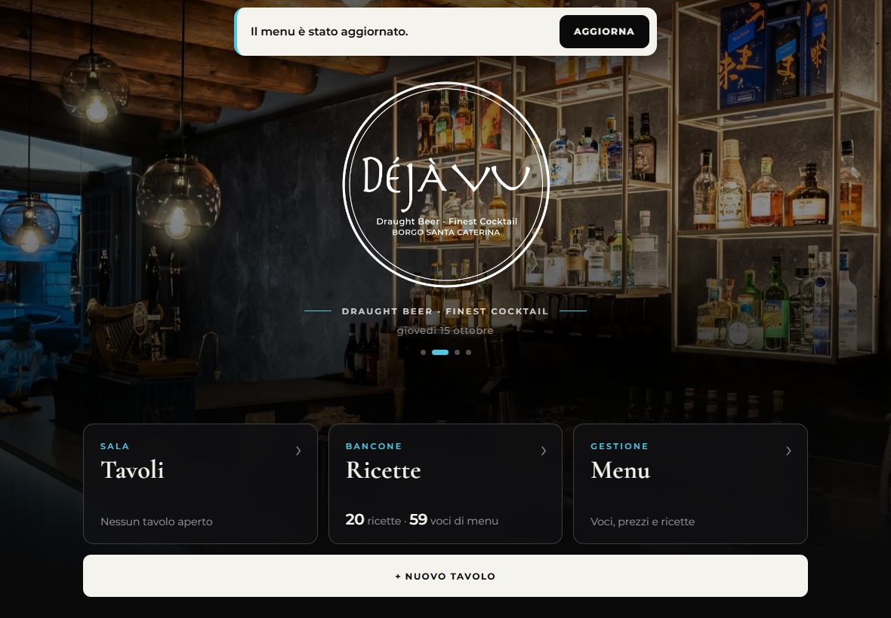
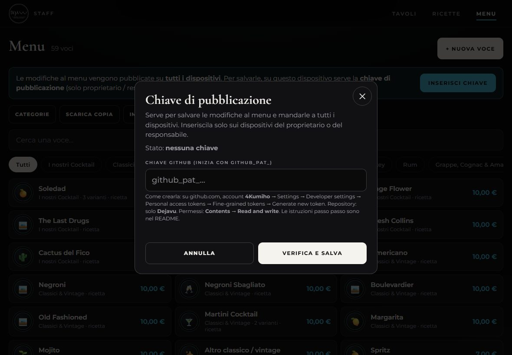

  

<h1 align="center">Déjà Vu · App Staff</h1>

  L'app del bancone del <b>Déjà Vu</b> (Borgo Santa Caterina, Bergamo): 
  <b>tavoli</b> con il conto che si calcola da solo, <b>pagamenti separati</b>, <b>ricette</b> dei cocktail 
  e un <b>menu modificabile dall'app</b> che si aggiorna su tutti i dispositivi.

  <a href="https://4kumiho.github.io/Dejavu/staff/"><b>👉 APRI L'APP 👈</b></a> 
  <code>https://4kumiho.github.io/Dejavu/staff/</code>

  
  &nbsp;
  

---

## 📲 Installa l'app (2 minuti, una volta sola)

Non serve nessun account e nessuno store. Si apre il link e si aggiunge l'icona alla schermata Home.
Dopo, l'app **funziona anche senza internet**.

> ⚠️ **Importante:** da quel momento apri l'app **sempre dall'icona** sulla schermata Home.
> I tavoli vengono salvati dentro l'app installata: se la apri dal browser normale vedi un'altra memoria (vuota).

<b>🍏 iPhone</b>

1. Tocca questo link: **[👉 Apri Déjà Vu Staff](https://4kumiho.github.io/Dejavu/staff/)**
2. Deve aprirsi in **Safari** (l'icona con la bussola blu).
   *Se si apre dentro un'altra app* (GitHub, WhatsApp, Instagram…): tocca **⋯** o l'icona della bussola e scegli **Apri in Safari**.
3. Aspetta che compaia la pagina nera con il logo Déjà Vu.
4. Tocca il tasto **Condividi** (il quadrato con la freccia verso l'alto ⬆️) nella barra in basso.
   *Se non lo vedi:* tocca **⋯** (tre puntini) in basso a destra, poi **Condividi**.
5. Scorri l'elenco verso il basso e tocca **Aggiungi alla schermata Home** ➕.
6. Se c'è l'opzione **Apri come app web**, lasciala **attiva**.
7. Tocca **Aggiungi** in alto a destra.
8. Sulla schermata Home trovi l'icona nera **Déjà Vu Staff**. ✅

<b>🍏 iPad</b>

1. Tocca questo link: **[👉 Apri Déjà Vu Staff](https://4kumiho.github.io/Dejavu/staff/)**
2. Deve aprirsi in **Safari** (l'icona con la bussola blu).
   *Se si apre dentro un'altra app* (GitHub, WhatsApp, Instagram…): tocca **⋯** o l'icona della bussola e scegli **Apri in Safari**.
3. Aspetta che compaia la pagina nera con il logo Déjà Vu.
4. Tocca il tasto **Condividi** (il quadrato con la freccia ⬆️) **in alto a destra**, accanto alla barra dell'indirizzo.
   *Se non lo vedi:* tocca **⋯** (tre puntini) in alto, poi **Condividi**.
5. Tocca **Aggiungi alla schermata Home** ➕.
6. Se c'è l'opzione **Apri come app web**, lasciala **attiva**.
7. Tocca **Aggiungi**.
8. Sulla schermata Home trovi l'icona nera **Déjà Vu Staff**. ✅

💡 L'app è pensata soprattutto per l'iPad: in orizzontale vedi l'ordine a sinistra e i drink a destra.

<b>🤖 Telefono Android</b>

**Con Google Chrome** (consigliato)
1. Tocca questo link: **[👉 Apri Déjà Vu Staff](https://4kumiho.github.io/Dejavu/staff/)**
2. Deve aprirsi in **Chrome**.
   *Se si apre dentro un'altra app* (GitHub, WhatsApp, Instagram…): tocca **⋮** e scegli **Apri in Chrome**.
3. Tocca **⋮** (tre puntini) in alto a destra.
4. Tocca **Installa app** oppure **Aggiungi a schermata Home**.
5. Conferma con **Installa** (o **Aggiungi**).
6. Trovi l'icona **Déjà Vu Staff** nella schermata Home e tra le app. ✅

**Con Samsung Internet**
1. Tocca il link **[👉 Apri Déjà Vu Staff](https://4kumiho.github.io/Dejavu/staff/)** e aprilo con **Samsung Internet**.
2. Tocca **☰** (tre righe) in basso a destra.
3. Tocca **Aggiungi pagina a** → **Schermata Home**.

<b>🤖 Tablet Android</b>

1. Tocca questo link: **[👉 Apri Déjà Vu Staff](https://4kumiho.github.io/Dejavu/staff/)**
2. Deve aprirsi in **Chrome**.
   *Se si apre dentro un'altra app* (GitHub, WhatsApp, Instagram…): tocca **⋮** e scegli **Apri in Chrome**.
3. Tocca **⋮** (tre puntini) **a destra della barra dell'indirizzo**.
   Su alcuni tablet compare direttamente un'icona **Installa** (uno schermo con una freccia) dentro la barra dell'indirizzo: puoi toccare quella.
4. Tocca **Installa app** oppure **Aggiungi a schermata Home**.
5. Conferma con **Installa**.
6. Trovi l'icona **Déjà Vu Staff** nella schermata Home. ✅

<b>💻 Computer (Windows o Mac)</b>

**Google Chrome**
1. Clicca il link **[👉 Apri Déjà Vu Staff](https://4kumiho.github.io/Dejavu/staff/)** (si apre in Chrome se è il tuo browser predefinito).
2. Nella barra dell'indirizzo, a destra, clicca l'icona **Installa** (uno schermo con una freccia ⬇️).
   *Se non c'è:* menu **⋮** → **Trasmetti, salva e condividi** → **Installa pagina come app…**
3. Clicca **Installa**. L'app si apre in una finestra sua e trovi l'icona nel menu Start / nel Launchpad.

**Microsoft Edge**
1. Clicca il link **[👉 Apri Déjà Vu Staff](https://4kumiho.github.io/Dejavu/staff/)**
2. Menu **⋯** in alto a destra → **App** → **Installa questo sito come app**.
3. Clicca **Installa**.

**Safari su Mac**
1. Clicca il link **[👉 Apri Déjà Vu Staff](https://4kumiho.github.io/Dejavu/staff/)**
2. Menu **File** → **Aggiungi al Dock**.
3. Clicca **Aggiungi**.

*Firefox non permette di installare app: puoi usarla normalmente nel browser, magari con un segnalibro.*

---

## 🍸 Come si usa

### 1. Pagina iniziale
Le foto del locale scorrono dietro il logo. Da qui vai a **Tavoli**, **Ricette** o **Menu**, oppure apri subito un **+ Nuovo tavolo**.
Nel riquadro *Tavoli* vedi quanti tavoli sono aperti e quanto c'è ancora da incassare.

### 2. Arriva un tavolo → **+ Nuovo tavolo**
Scrivi il nome che vuoi (*Tavolo 4*, *Divanetto*, *Esterno 2*…) e premi **Crea tavolo**.

### 3. Segna cosa prendono
Tocca i drink nell'elenco a destra: si aggiungono all'ordine e **il totale si aggiorna da solo**.
Con **−** e **+** cambi le quantità. Cerca per nome o filtra per categoria (Cocktail, Spritz, Birre, Vini, Menu Sfizioso…).

Quando una voce ha più scelte (gusto dello spritz, gin, birra piccola o pinta, calice o bottiglia…) si apre una finestra per scegliere:

Serve qualcosa che non è nel menu? Usa **+ Voce libera** in fondo all'elenco e scrivi nome e prezzo.

### 4. Pagano separati → **Paga separato**
Seleziona cosa paga la persona alla cassa (con **+** e **−** su ogni riga). Vedi subito **quanto incassare** e **quanto resta**.
Premi **Incassa** e quelle voci spariscono dal tavolo. Ripeti per la persona successiva.

### 5. Pagano tutto → **Chiudi tavolo**
Ti mostra il totale da incassare e, confermando, elimina il tavolo.

### 6. Tutti i tavoli aperti
Dalla scheda **Tavoli** vedi tutti i tavoli con articoli, da quanto sono aperti e il totale.

### 7. Ricette
Tutti i cocktail con bicchiere, ghiaccio, metodo, guarnizione, dosi e passaggi.
Anche dall'ordine di un tavolo puoi toccare il nome di un cocktail per aprirne la ricetta.

  
  &nbsp;
  

### 8. Modificare il menu (proprietario / responsabile)
Dalla scheda **Menu** puoi cambiare tutto senza toccare il codice:

- **Modificare una voce**: toccala → cambi nome, prezzo, categoria, icona, descrizione → **Salva**.
- **Varianti**: le scelte che compaiono quando aggiungi la voce a un tavolo (gusti dello spritz, gin, piccola/media, calice/bottiglia…), ognuna con il suo prezzo se diverso.
- **Ricetta e dosi**: bicchiere, ghiaccio, metodo, guarnizione, **ingredienti con le quantità** e passaggi.
- **Aggiungere** una voce: **+ Nuova voce**. **Togliere** una voce: aprila → **Elimina voce** (va toccato due volte, per sicurezza).
- **Categorie**: rinominarle, riordinarle, aggiungerne di nuove.

  
  &nbsp;
  

#### 🔄 Le modifiche arrivano a tutti
Quando premi **Salva**, il nuovo menu viene pubblicato online. Tutti gli altri dispositivi con l'app,
entro un paio di minuti (o appena riaprono l'app), mostrano in alto **«Il menu è stato aggiornato · Aggiorna»**:
basta toccare **Aggiorna**.

- I **tavoli già aperti** mantengono i prezzi con cui sono stati segnati; i nuovi ordini usano il menu nuovo.
- Per salvare serve **internet**.
- **Scarica copia** salva un file con tutto il menu (utile come backup).

#### 🔑 La chiave di pubblicazione (una volta sola, solo sui dispositivi di chi modifica il menu)
Per poter **salvare** le modifiche, il dispositivo deve avere la *chiave di pubblicazione*.
Chi non ha la chiave può usare l'app normalmente ma non può cambiare il menu (così nessuno lo modifica per sbaglio).

**Crea la chiave** (da computer o telefono, con l'account GitHub **4Kumiho**):
1. Apri questo link (molti campi sono già compilati): **[👉 Crea la chiave su GitHub](https://github.com/settings/personal-access-tokens/new?name=D%C3%A9j%C3%A0%20Vu%20menu&description=Chiave%20per%20modificare%20il%20menu%20dall%27app%20staff&target_name=4Kumiho&expires_in=366&contents=write)** (accedi con l'account 4Kumiho se te lo chiede).
2. **Token name**: scrivi `Déjà Vu menu`.
3. **Expiration**: scegli la durata più lunga disponibile (quando scade, basta crearne una nuova).
4. **Repository access**: scegli **Only select repositories** e seleziona **4Kumiho/Dejavu**.
5. **Permissions** → **Repository permissions** → **Contents**: scegli **Read and write**.
6. In fondo premi **Generate token** (e conferma).
7. **Copia** la chiave che compare (inizia con `github_pat_…`). ⚠️ GitHub la mostra una volta sola.

**Inseriscila nell'app**:
1. Apri l'app → scheda **Menu** → **Impostazioni** (oppure **Inserisci chiave**).
2. Incolla la chiave e premi **Verifica e salva**.
3. Se è tutto giusto compare *«Chiave salvata»* e il pulsante diventa **Impostazioni ✓**.

> 🔒 Inserisci la chiave solo sui dispositivi del proprietario o del responsabile.
> Se un dispositivo con la chiave viene perso: su GitHub vai in **Settings → Developer settings → Personal access tokens → Fine-grained tokens** ed elimina la chiave.

### Sul telefono
Stessa app, adattata allo schermo: dentro un tavolo usi le due schede **Ordine** e **+ Aggiungi**.

  
  &nbsp;
  

---

## ❓ Domande frequenti

**Serve internet?**
Solo la prima volta (per installarla) e per ricevere gli aggiornamenti del menu. Poi funziona anche offline.

**Se chiudo l'app o spengo l'iPad perdo i tavoli?**
No, restano salvati sul dispositivo.

**I tavoli si vedono su tutti gli iPad?**
No: ogni dispositivo ha i suoi tavoli. Usate un solo dispositivo per segnare i tavoli.

**Ho cambiato il menu ma un dispositivo non lo vede.**
Deve essere collegato a internet: aprendo l'app compare in alto **«Il menu è stato aggiornato · Aggiorna»**. Tocca **Aggiorna**.
Se hai appena salvato, aspetta un paio di minuti: la pubblicazione online richiede 1–2 minuti.

**Quando salvo il menu dice che manca la chiave / che la chiave non è valida.**
Vedi [La chiave di pubblicazione](#-la-chiave-di-pubblicazione-una-volta-sola-solo-sui-dispositivi-di-chi-modifica-il-menu): probabilmente non è stata inserita su quel dispositivo oppure è scaduta.

**Esce «È disponibile una nuova versione dell'app».**
È un aggiornamento dell'app: tocca **Aggiorna** e si ricarica con le novità.

**Voglio controllare io se ci sono aggiornamenti.**
Tocca **↻ Aggiorna** (in alto a destra, in ogni pagina). Se c'è una nuova versione dell'app o del menu si aggiorna subito,
altrimenti compare *«App già aggiornata»*.

**L'icona apre GitHub invece dell'app.**
Hai aggiunto la pagina sbagliata. Tieni premuto sull'icona → **Rimuovi**, poi rifai l'installazione da questo link: **[👉 Apri Déjà Vu Staff](https://4kumiho.github.io/Dejavu/staff/)**

**Ho cancellato i dati di Safari / rimosso l'icona.**
I tavoli aperti in quel momento vengono cancellati. Il menu e le ricette invece si riscaricano da soli.

---

## 🛠️ Per chi gestisce il progetto

### Cosa c'è dentro
| Cartella | Cosa contiene |
|---|---|
| `staff/` | L'app: pagina iniziale, tavoli, ricette |
| `shared/menu.json` | **Il menu**: voci, prezzi, varianti e ricette. Si modifica dall'app (sezione Menu) |
| `shared/config.js` | Nome del locale, logo, foto della pagina iniziale, repository dove pubblicare il menu |
| `shared/img/` | Foto che scorrono nella pagina iniziale |
| `shared/` | Logo, colori, caratteri |
| `Foto/Menu/`, `Foto/Locale/` | Foto originali del menu e del locale |
| `docs/screenshots/` | Le immagini di questo README |

### Come funziona l'aggiornamento del menu
- Il menu ufficiale è `shared/menu.json`. L'app lo modifica tramite l'API di GitHub (commit su `main`) usando la chiave
  di pubblicazione salvata sul dispositivo; GitHub Pages lo rimette online in 1–2 minuti.
- Ogni dispositivo tiene una copia del menu per funzionare offline e controlla `menu.json` ogni 2 minuti e a ogni apertura:
  se il campo `versione` è più recente, mostra l'avviso **Aggiorna**.
- Se due persone salvano insieme, la seconda riceve un avviso e ricarica il menu più recente prima di riprovare.
- Si può anche modificare `shared/menu.json` a mano: ricordati di aggiornare `versione` (data e ora ISO) perché gli altri dispositivi se ne accorgano.

Ogni modifica pubblicata su `main` va online da sola in 1–2 minuti. Le modifiche al codice dell'app mostrano l'avviso
«nuova versione dell'app» quando cambia `CACHE` in `staff/sw.js`.

### Provarla sul computer senza installarla
- Doppio clic su `staff/index.html` (con Chrome o Edge), oppure
- dal terminale nella cartella del progetto: `python -m http.server 8000` e apri http://localhost:8000/staff/

### Pubblicazione
L'app è pubblicata con **GitHub Pages** (Settings → Pages → Branch `main`, cartella `/ (root)`).
Per avere una propria copia: **Fork** del repository e attivare GitHub Pages sul fork.
