

  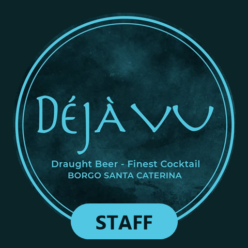

<h1 align="center">Déjà Vu · App Staff</h1>

  L'app del bancone del <b>Déjà Vu</b> (Borgo Santa Caterina, Bergamo): 
  <b>tavoli</b> con il conto che si calcola da solo, <b>pagamenti separati</b>, <b>ricette</b> dei cocktail 
  un <b>menu modificabile dall'app</b> e la <b>cronologia</b> degli incassi.

  <a href="https://4kumiho.github.io/Dejavu/Dejavu-Staff.apk"><b>👉 SCARICA L'APP PER ANDROID (APK) 👈</b></a> 
  <a href="#-installa-lapp-sul-tablet-android-del-bar-5-minuti-una-volta-sola">Come si installa</a>

  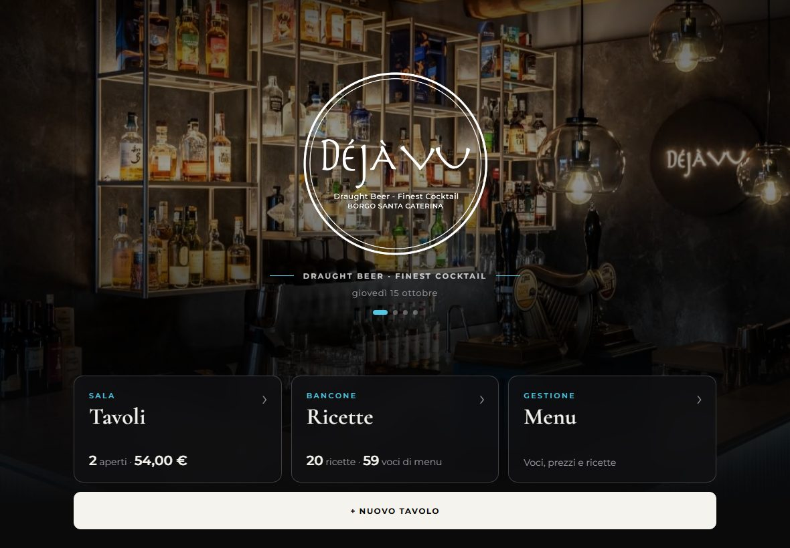
  &nbsp;
  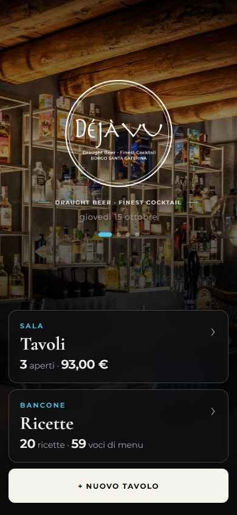

---

## 📲 Installa l'app sul tablet Android del bar (5 minuti, una volta sola)

L'app si installa da un file, **`Dejavu-Staff.apk`**: non serve il Play Store né un account.
Dopo l'installazione **funziona senza internet** e tiene tutto sul tablet: tavoli, menu modificato e cronologia degli incassi.

> ℹ️ L'app è pensata per **un solo tablet**, quello del bar: menu e cronologia restano su quel tablet.

### 1. Porta il file `Dejavu-Staff.apk` sul tablet
Scegli **uno** di questi modi:

- **A · Dal tablet, con il link (il più semplice)**
  Sul tablet apri **Chrome** e vai su: **[👉 Scarica Dejavu-Staff.apk](https://4kumiho.github.io/Dejavu/Dejavu-Staff.apk)**
  `https://4kumiho.github.io/Dejavu/Dejavu-Staff.apk`
  Se Chrome avvisa *«Questo tipo di file può danneggiare il dispositivo»*, tocca **Scarica comunque**.
- **B · Dal computer, con il cavo USB**
  1. Collega il tablet al computer con il cavo.
  2. Sul tablet tocca la notifica **«Ricarica tramite USB»** e scegli **Trasferimento file**.
  3. Sul computer apri **Esplora file** → il tablet → **Download**, e copia lì `Dejavu-Staff.apk`.
- **C · Con Google Drive, WhatsApp o email**
  Mandati il file `Dejavu-Staff.apk` e aprilo dal tablet (scaricalo, poi aprilo).

### 2. Installa
1. Sul tablet apri il file: tocca la notifica del download, oppure apri l'app **File** (o **I miei file** sui Samsung) → **Download** → `Dejavu-Staff.apk`.
2. La **prima volta** Android blocca l'installazione e dice che per sicurezza non è consentito installare app sconosciute:
   tocca **Impostazioni** → attiva **Consenti da questa origine** → torna indietro con la freccia ←.
3. Tocca **Installa**.
4. Se compare **Google Play Protect** (*«App non sicura bloccata»* / *«Inviare l'app per la scansione?»*):
   tocca **Altri dettagli** → **Installa comunque** (oppure **Non inviare**). È normale per le app che non arrivano dal Play Store.
5. Alla fine tocca **Apri**. Trovi l'icona nera **Déjà Vu Staff** tra le app: tienila premuta e trascinala sulla schermata Home. ✅

<b>Non trovo «Consenti da questa origine»</b>

Dipende dal modello. Vai in **Impostazioni** del tablet e cerca *«app sconosciute»* con la lente, oppure:
- **Samsung**: Impostazioni → **Applicazioni** → ⋮ → **Accesso speciale** → **Installa app sconosciute** → scegli l'app con cui apri il file (**Chrome** o **I miei file**) → attiva.
- **Altri tablet**: Impostazioni → **App** → **Accesso speciale per le app** → **Installa app sconosciute** → **Chrome** (o **File**) → **Consenti da questa origine**.

Poi riapri il file `Dejavu-Staff.apk`.

### 3. Prima apertura
- L'app parte con il **menu originale** già dentro: si può usare subito, anche senza internet.
- Il menu si cambia da **Modifica menu** e resta salvato sul tablet (vedi [Modificare il menu](#10-modificare-il-menu--modifica-menu-proprietario--responsabile)).
- 💡 Consigliato: in Impostazioni del tablet → **Display** → **Spegnimento schermo**, metti un tempo lungo (per esempio 10 minuti).

### 🔄 Aggiornare l'app
Quando c'è una versione nuova, l'app mostra in alto **«È disponibile una nuova versione dell'app · Scarica»**
(puoi controllare anche tu con **↻ Aggiorna**, in alto a destra).
1. Tocca **Scarica** e aspetta il download.
2. Apri il file e tocca **Aggiorna**.
3. Tavoli aperti, menu e cronologia **restano**.

> ⚠️ **Non disinstallare mai l'app** per aggiornarla: disinstallando si cancellano menu modificato e cronologia degli incassi.
> Se proprio devi (o se cambi tablet), prima fai **Scarica copia** sia in **Menu** sia in **Cronologia**: i file finiscono nella cartella **Download/Deja Vu** del tablet.

---

## 🌐 Usarla su altri dispositivi (web app)

Sugli altri dispositivi (iPhone, iPad, computer…) l'app si può usare anche dal browser e aggiungere alla schermata Home.
Ogni dispositivo ha i **suoi** tavoli, il **suo** menu e la **sua** cronologia: per il bar usate il tablet con l'app Android.

> ⚠️ Una volta aggiunta alla schermata Home, apri l'app **sempre dall'icona**: se la apri dal browser normale vedi un'altra memoria (vuota).

<b>🍏 iPhone</b>

1. Tocca questo link: **[👉 Apri Déjà Vu Staff](https://4kumiho.github.io/Dejavu/staff/)**
2. Deve aprirsi in **Safari** (l'icona con la bussola blu).
   *Se si apre dentro un'altra app* (GitHub, WhatsApp, Instagram…): tocca **⋯** o l'icona della bussola e scegli **Apri in Safari**.
3. Aspetta che compaia la pagina nera con il logo Déjà Vu.
4. Tocca il tasto **Condividi** (il quadrato con la freccia verso l'alto ⬆️) nella barra in basso.
   *Se non lo vedi:* tocca **⋯** (tre puntini) in basso a destra, poi **Condividi**.
5. Scorri l'elenco verso il basso e tocca **Aggiungi alla schermata Home** ➕.
6. Se c'è l'opzione **Apri come app web**, lasciala **attiva**.
7. Tocca **Aggiungi** in alto a destra.
8. Sulla schermata Home trovi l'icona nera **Déjà Vu Staff**. ✅

<b>🍏 iPad</b>

1. Tocca questo link: **[👉 Apri Déjà Vu Staff](https://4kumiho.github.io/Dejavu/staff/)**
2. Deve aprirsi in **Safari** (l'icona con la bussola blu).
   *Se si apre dentro un'altra app* (GitHub, WhatsApp, Instagram…): tocca **⋯** o l'icona della bussola e scegli **Apri in Safari**.
3. Aspetta che compaia la pagina nera con il logo Déjà Vu.
4. Tocca il tasto **Condividi** (il quadrato con la freccia ⬆️) **in alto a destra**, accanto alla barra dell'indirizzo.
   *Se non lo vedi:* tocca **⋯** (tre puntini) in alto, poi **Condividi**.
5. Tocca **Aggiungi alla schermata Home** ➕.
6. Se c'è l'opzione **Apri come app web**, lasciala **attiva**.
7. Tocca **Aggiungi**.
8. Sulla schermata Home trovi l'icona nera **Déjà Vu Staff**. ✅

💡 L'app è pensata soprattutto per l'iPad: in orizzontale vedi l'ordine a sinistra e i drink a destra.

<b>🤖 Telefono Android</b>

**Con Google Chrome** (consigliato)
1. Tocca questo link: **[👉 Apri Déjà Vu Staff](https://4kumiho.github.io/Dejavu/staff/)**
2. Deve aprirsi in **Chrome**.
   *Se si apre dentro un'altra app* (GitHub, WhatsApp, Instagram…): tocca **⋮** e scegli **Apri in Chrome**.
3. Tocca **⋮** (tre puntini) in alto a destra.
4. Tocca **Installa app** oppure **Aggiungi a schermata Home**.
5. Conferma con **Installa** (o **Aggiungi**).
6. Trovi l'icona **Déjà Vu Staff** nella schermata Home e tra le app. ✅

**Con Samsung Internet**
1. Tocca il link **[👉 Apri Déjà Vu Staff](https://4kumiho.github.io/Dejavu/staff/)** e aprilo con **Samsung Internet**.
2. Tocca **☰** (tre righe) in basso a destra.
3. Tocca **Aggiungi pagina a** → **Schermata Home**.

<b>🤖 Tablet Android — come web app</b>

1. Tocca questo link: **[👉 Apri Déjà Vu Staff](https://4kumiho.github.io/Dejavu/staff/)**
2. Deve aprirsi in **Chrome**.
   *Se si apre dentro un'altra app* (GitHub, WhatsApp, Instagram…): tocca **⋮** e scegli **Apri in Chrome**.
3. Tocca **⋮** (tre puntini) **a destra della barra dell'indirizzo**.
   Su alcuni tablet compare direttamente un'icona **Installa** (uno schermo con una freccia) dentro la barra dell'indirizzo: puoi toccare quella.
4. Tocca **Installa app** oppure **Aggiungi a schermata Home**.
5. Conferma con **Installa**.
6. Trovi l'icona **Déjà Vu Staff** nella schermata Home. ✅

<b>💻 Computer (Windows o Mac)</b>

**Google Chrome**
1. Clicca il link **[👉 Apri Déjà Vu Staff](https://4kumiho.github.io/Dejavu/staff/)** (si apre in Chrome se è il tuo browser predefinito).
2. Nella barra dell'indirizzo, a destra, clicca l'icona **Installa** (uno schermo con una freccia ⬇️).
   *Se non c'è:* menu **⋮** → **Trasmetti, salva e condividi** → **Installa pagina come app…**
3. Clicca **Installa**. L'app si apre in una finestra sua e trovi l'icona nel menu Start / nel Launchpad.

**Microsoft Edge**
1. Clicca il link **[👉 Apri Déjà Vu Staff](https://4kumiho.github.io/Dejavu/staff/)**
2. Menu **⋯** in alto a destra → **App** → **Installa questo sito come app**.
3. Clicca **Installa**.

**Safari su Mac**
1. Clicca il link **[👉 Apri Déjà Vu Staff](https://4kumiho.github.io/Dejavu/staff/)**
2. Menu **File** → **Aggiungi al Dock**.
3. Clicca **Aggiungi**.

*Firefox non permette di installare app: puoi usarla normalmente nel browser, magari con un segnalibro.*

---

## 🍸 Come si usa

### 1. Pagina iniziale
Le foto del locale scorrono dietro il logo e c'è subito il riquadro **Tavoli**, con quanti tavoli sono aperti e quanto c'è ancora da incassare.
**Scorrendo verso il basso** trovi **Ricette**, **I nostri Prodotti**, **Visualizza menu**, **Modifica menu** e **Cronologia**.
Le stesse voci sono anche nella barra in alto, in ogni pagina.

  
  &nbsp;
  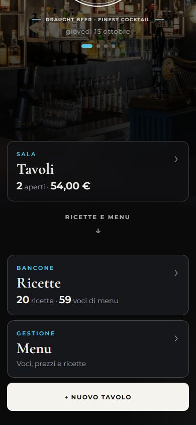

### 2. Arriva un tavolo → **+ Nuovo tavolo**
Dalla pagina **Tavoli** premi **+ Nuovo tavolo**. Scrivi il nome che vuoi (*Tavolo 4*, *Divanetto*, *Esterno 2*…) e premi **Crea tavolo**.

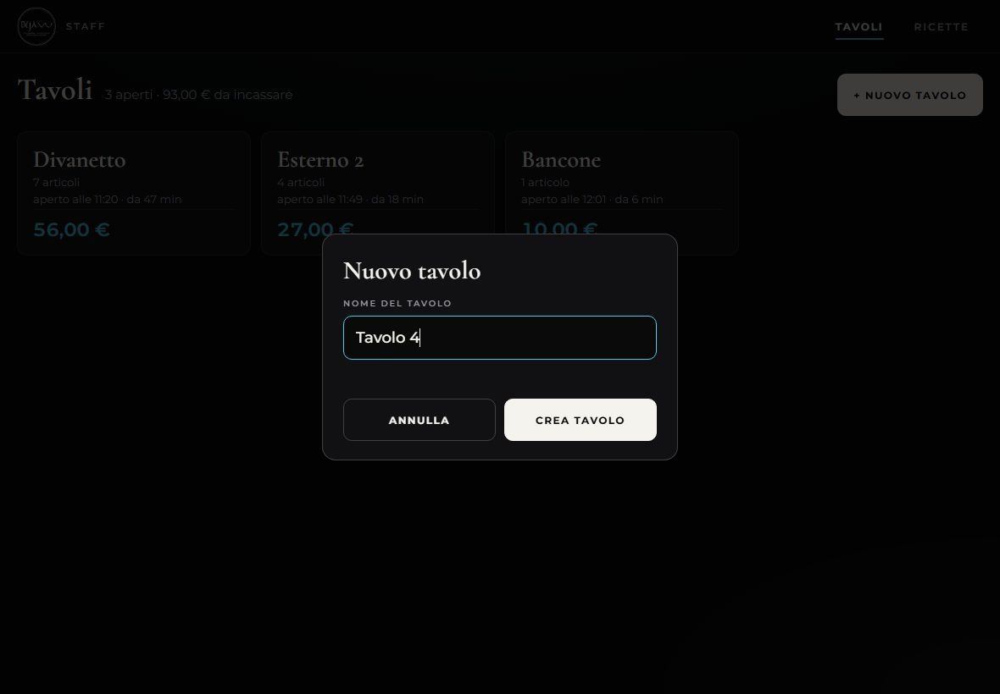

### 3. Segna cosa prendono
Tocca i drink nell'elenco a destra: si aggiungono all'ordine e **il totale si aggiorna da solo**.
Con **−** e **+** cambi le quantità. Cerca per nome o filtra per categoria (Cocktail, Spritz, Birre, Vini, Menu Sfizioso…).

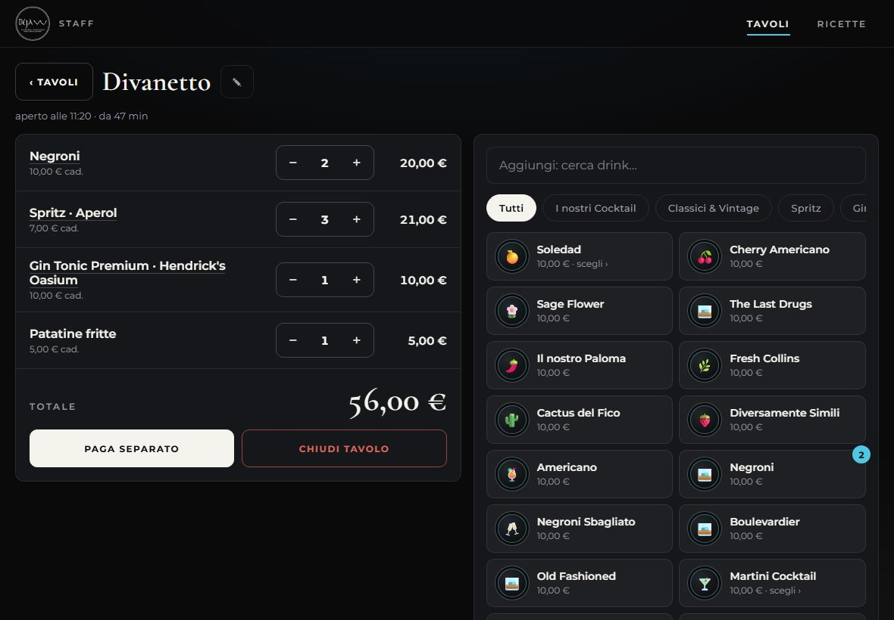

Quando una voce ha più scelte (gusto dello spritz, gin, birra piccola o pinta, calice o bottiglia…) si apre una finestra per scegliere:

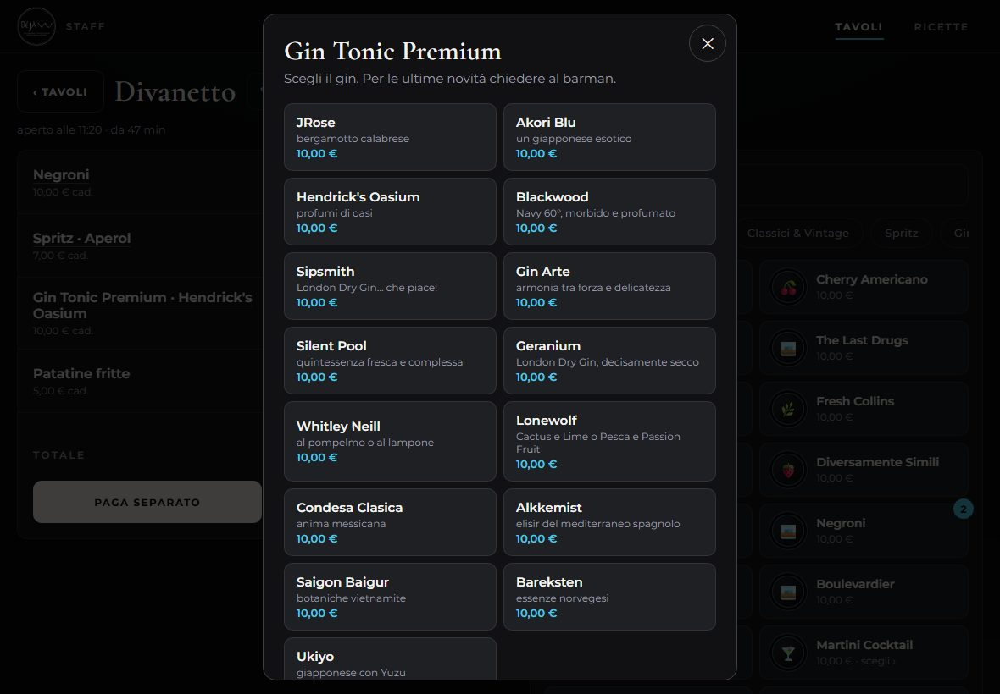

Serve qualcosa che non è nel menu? Usa **+ Voce libera** in fondo all'elenco e scrivi nome e prezzo.

### 4. Pagano separati → **Paga separato**
Seleziona cosa paga la persona alla cassa (con **+** e **−** su ogni riga). Vedi subito **quanto incassare** e **quanto resta**.
Premi **Incassa** e quelle voci spariscono dal tavolo. Ripeti per la persona successiva.

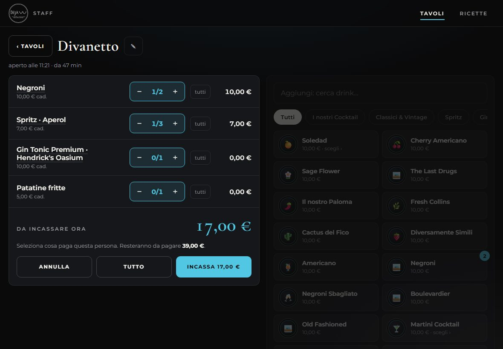

### 5. Pagano tutto → **Chiudi tavolo**
Ti mostra il totale da incassare e, confermando, elimina il tavolo.

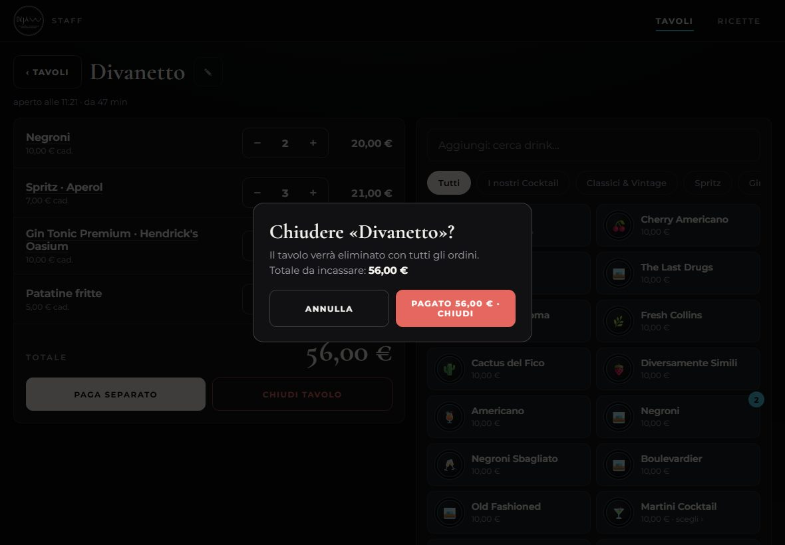

### 6. Tutti i tavoli aperti
Dalla scheda **Tavoli** vedi tutti i tavoli con articoli, da quanto sono aperti e il totale.

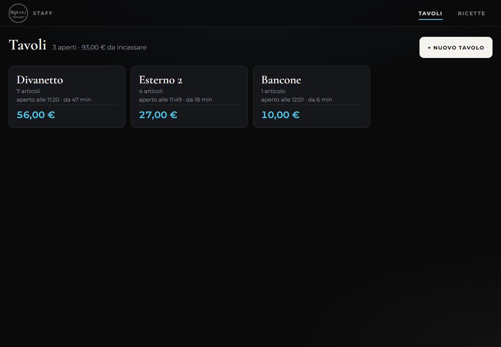

### 7. Ricette
Tutti i cocktail con bicchiere, ghiaccio, metodo, guarnizione, dosi e passaggi.
Anche dall'ordine di un tavolo puoi toccare il nome di un cocktail per aprirne la ricetta.

  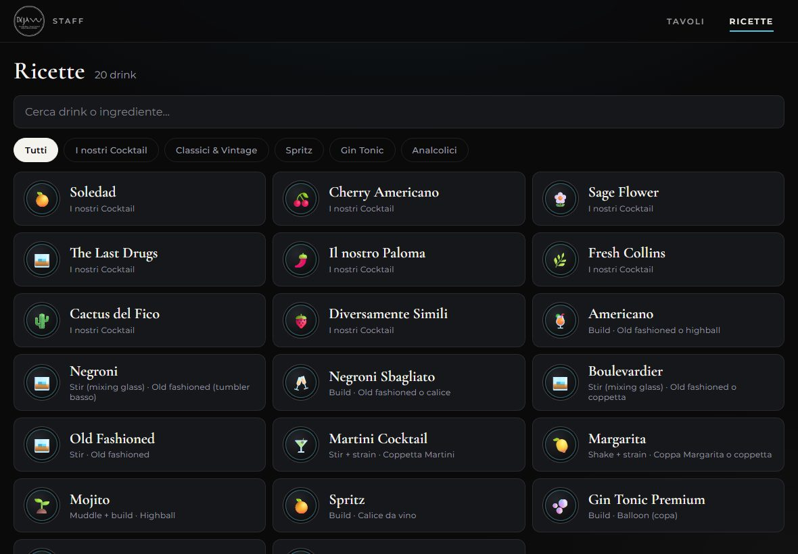
  &nbsp;
  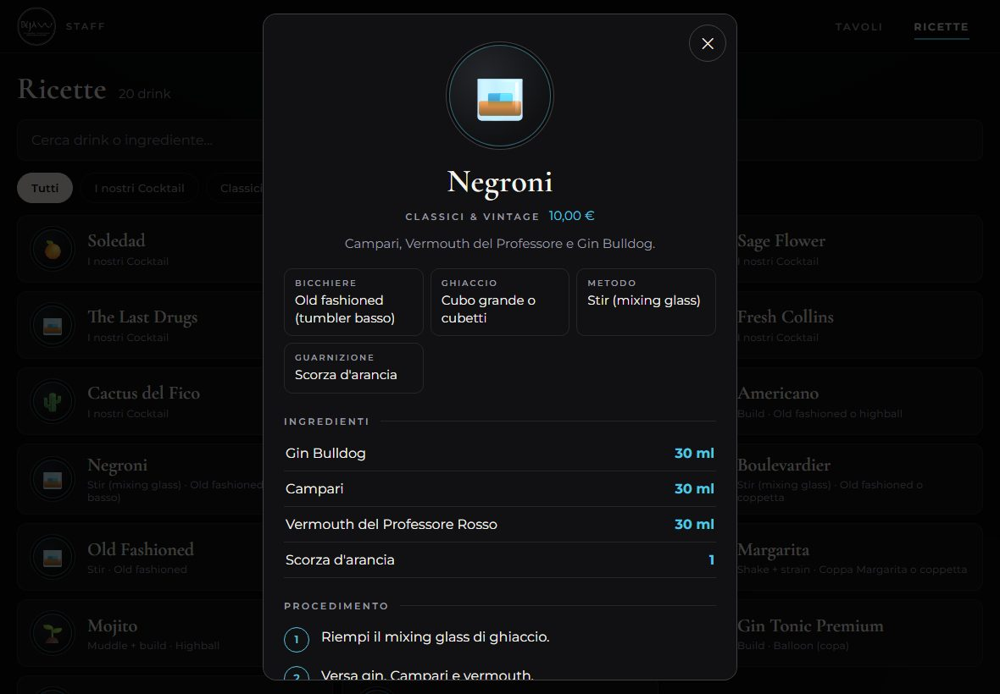

### 8. I nostri Prodotti
La bottigliera del locale: foto di ogni bottiglia, tipo, produttore e origine, la storia, il gusto e *«consigliato a chi ama»*.
In **Lo usiamo in** trovi i drink che la usano (toccali per aprire la ricetta). Nelle ricette, accanto agli ingredienti,
c'è la miniatura della bottiglia: toccandola si apre la sua scheda.

### 9. Mostrare il menu del locale → **Visualizza menu**
Le pagine del menu cartaceo del Déjà Vu, una sotto l'altra: si scorrono col dito, per farle vedere ai clienti.
Con **−** e **+** in alto a destra cambi la grandezza delle pagine; toccando la percentuale torni al 100%.
Le immagini sono in `shared/img/menu-cartaceo/` (gli originali in `Foto/Menu/`).

### 10. Modificare il menu → **Modifica menu** (proprietario / responsabile)
Da **Modifica menu** puoi cambiare tutto senza toccare il codice:

- **Modificare una voce**: toccala → cambi nome, prezzo, categoria, icona, descrizione → **Salva**.
- **Varianti**: le scelte che compaiono quando aggiungi la voce a un tavolo (gusti dello spritz, gin, piccola/media, calice/bottiglia…), ognuna con il suo prezzo se diverso.
- **Ricetta e dosi**: bicchiere, ghiaccio, metodo, guarnizione, **ingredienti con le quantità** e passaggi.
- **Aggiungere** una voce: **+ Nuova voce**. **Togliere** una voce: aprila → **Elimina voce** (va toccato due volte, per sicurezza).
- **Categorie**: rinominarle, riordinarle, aggiungerne di nuove.

  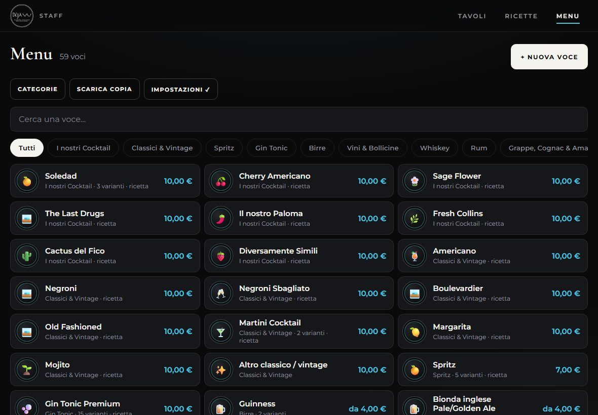
  &nbsp;
  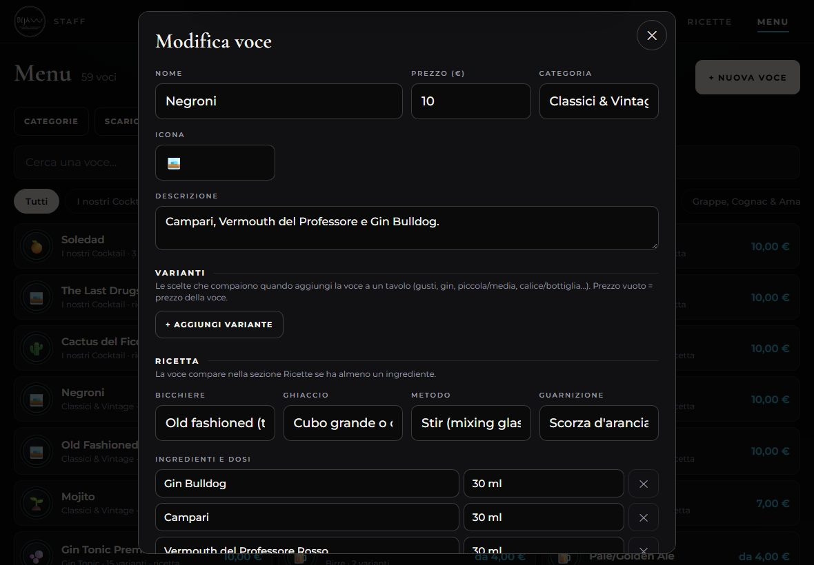

#### 💾 Le modifiche restano sul dispositivo
Quando premi **Salva**, il menu nuovo si usa subito ed è salvato sul dispositivo (non serve internet, non serve nessuna chiave).
L'app è pensata per **un solo tablet**, quello del bar: le modifiche fatte lì non vanno su altri dispositivi.

- I **tavoli già aperti** mantengono i prezzi con cui sono stati segnati; i nuovi ordini usano il menu nuovo.
- **Scarica copia** salva un file con tutto il menu (nell'app Android: cartella **Download/Deja Vu**). Fallo ogni tanto, come backup.
- **Carica copia** rimette un menu salvato con *Scarica copia* (per esempio su un tablet nuovo).
- **Ripristina originale** torna al menu di partenza (`shared/menu.json`).

### 11. Cronologia (titolare)
Tutto quello che viene incassato resta salvato: ogni **Incassa** di *Paga separato* e ogni **Chiudi tavolo**
(che vuol dire «pagato tutto»), con data, ora e prodotti. I prodotti tolti con **−** prima del pagamento non contano.

Una **serata** va dalle **8:00 alle 7:59 del giorno dopo**: un tavolo pagato all'1:30 di notte conta nella serata del giorno prima.

In alto scegli il **periodo**: *Serata*, *Settimana*, *Mese*, *Anno* o *Tutto*; con **‹ ›** vai al periodo prima o dopo,
con **Oggi** torni a quello attuale. Il periodo vale per tutte e tre le pagine:

- **Serate**: incasso del periodo, media per tavolo e per serata, serata migliore e il grafico dell'incasso
  (per ora dentro una serata, per serata in una settimana o un mese, per mese in un anno).
  Tocca una colonna per vedere l'importo, toccala di nuovo per aprire quella serata. Sotto, la classifica delle serate migliori.
- **Prodotti più venduti**: la classifica per pezzi o per incasso, filtrabile per gruppo del menu,
  i **meno venduti** e le voci del menu **mai vendute** nel periodo.
- **Tavoli chiusi**: tutti i tavoli divisi per serata, con orari, durata e totale; si cerca per nome del tavolo o per prodotto.
  Toccando un tavolo vedi cosa ha preso e i singoli pagamenti; da lì lo puoi anche **eliminare dalla cronologia**
  (per esempio un tavolo segnato per sbaglio: va toccato due volte).

Gli incassi dei tavoli ancora aperti contano già nelle serate e nei prodotti; nei *Tavoli chiusi* compaiono quando li chiudi.
**Scarica copia** salva tutta la cronologia in un file (cartella **Download/Deja Vu** del tablet): fallo ogni tanto, come backup.

Dalla pagina iniziale, il riquadro **Cronologia** mostra quanto si è incassato stasera.

### Sul telefono
Stessa app, adattata allo schermo: dentro un tavolo usi le due schede **Ordine** e **+ Aggiungi**.

  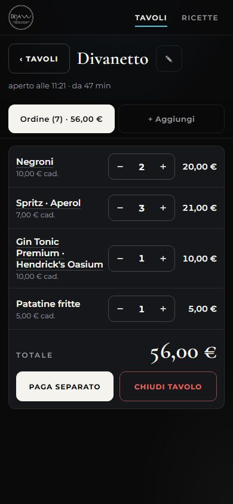
  &nbsp;
  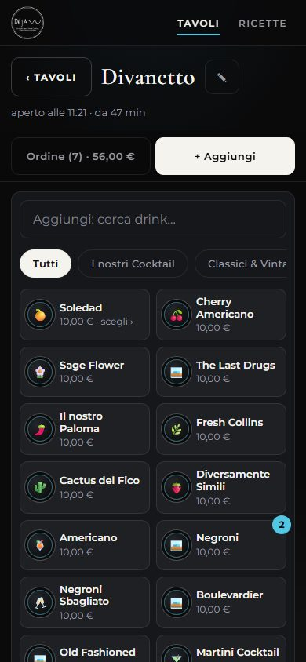

---

## ❓ Domande frequenti

**Serve internet?**
No: funziona tutto senza internet. Serve solo per installarla e per controllare se c'è una nuova versione dell'app.

**Se chiudo l'app o spengo l'iPad perdo i tavoli?**
No, restano salvati sul dispositivo.

**I tavoli si vedono su tutti gli iPad?**
No: ogni dispositivo ha i suoi tavoli. Usate un solo dispositivo per segnare i tavoli.

**Ho cambiato il menu su un dispositivo ma un altro non lo vede.**
È normale: il menu modificato resta sul dispositivo dove l'hai cambiato. Per copiarlo su un altro: **Scarica copia** sul primo, **Carica copia** sull'altro (in **Modifica menu**).

**Esce «È disponibile una nuova versione dell'app».**
È un aggiornamento dell'app: tocca **Aggiorna** e si ricarica con le novità.

**Voglio controllare io se ci sono aggiornamenti.**
Tocca **↻ Aggiorna** (in alto a destra, in ogni pagina). Se c'è una nuova versione dell'app te lo dice,
altrimenti compare *«App già aggiornata»*.

**L'icona apre GitHub invece dell'app.**
Hai aggiunto la pagina sbagliata. Tieni premuto sull'icona → **Rimuovi**, poi rifai l'installazione da questo link: **[👉 Apri Déjà Vu Staff](https://4kumiho.github.io/Dejavu/staff/)**

**Ho cancellato i dati di Safari / rimosso l'icona / disinstallato l'app.**
I tavoli aperti, il menu modificato e la cronologia di quel dispositivo vengono cancellati.
Si rimettono con **Carica copia** (menu) se avevi salvato una copia. Per questo conviene fare ogni tanto **Scarica copia** di menu e cronologia.

---

## 🛠️ Per chi gestisce il progetto

### Cosa c'è dentro
| Cartella | Cosa contiene |
|---|---|
| `staff/` | L'app: pagina iniziale, tavoli, ricette, menu, cronologia |
| `android/` | L'app Android (APK) |
| `shared/menu.json` | **Il menu originale**: voci, prezzi, varianti e ricette. Si modifica dall'app (sezione Menu) |
| `shared/config.js` | Nome del locale, logo, foto della pagina iniziale, indirizzo del sito |
| `shared/img/` | Foto che scorrono nella pagina iniziale |
| `shared/img/menu-cartaceo/` | Le pagine del menu cartaceo per **Visualizza menu** (elenco in `shared/config.js`) |
| `shared/img/prodotti/` | Le foto delle bottiglie di **I nostri Prodotti** |
| `shared/` | Logo, colori, caratteri |
| `Foto/Menu/`, `Foto/Locale/` | Foto originali del menu e del locale |
| `docs/screenshots/` | Le immagini di questo README |

### Come funziona il menu
- `shared/menu.json` è il **menu originale**: è quello che si usa al primo avvio e con *Ripristina originale*.
- Le modifiche fatte dall'app restano sul dispositivo (app Android: file `dati/menu.json` con la copia `.bak`; browser: nella sua memoria).
  Cambiare `shared/menu.json` non tocca il menu già modificato su un dispositivo.
- **I nostri Prodotti** (`prodotti` in `shared/menu.json`) non si modificano dall'app: si usano sempre quelli di `shared/menu.json`,
  quindi le bottiglie nuove arrivano sul tablet con un aggiornamento dell'app anche se lì il menu è stato modificato.

Ogni modifica pubblicata su `main` va online da sola in 1–2 minuti. Le modifiche al codice della web app mostrano l'avviso
«nuova versione dell'app» quando cambia `CACHE` in `staff/sw.js`; per l'app Android vedi sotto.

### Provarla sul computer senza installarla
- Doppio clic su `staff/index.html` (con Chrome o Edge), oppure
- dal terminale nella cartella del progetto: `python -m http.server 8000` e apri http://localhost:8000/staff/

### App Android (`android/`)
- È la stessa web app di `staff/` + `shared/`, copiata dentro l'APK e aperta in una WebView.
  Funziona senza internet: menu modificato (`dati/menu.json`) e cronologia restano in file dentro l'app.
- La cronologia è in file dentro l'app (`dati/cronologia/AAAA-MM.json` + `.bak`), come in Reef; nel browser sta nella memoria del browser.
- **Ricreare l'APK** (PowerShell, dalla radice della repo): `.\android\build.ps1` → `Dejavu-Staff.apk`.
  La prima volta scarica Java, Android SDK e Gradle in `..\.android-tools` (fuori dalla repo).
- **Provare l'APK sul computer**, senza tablet: `.\android\prova-emulatore.ps1`. Apre un tablet Android virtuale (emulatore),
  installa `Dejavu-Staff.apk` e avvia l'app. La prima volta scarica emulatore e Android 15 (circa 2 GB).
  Si usa con il mouse come un tablet; il tasto ◀ in basso è il tasto indietro. Dopo una nuova build basta rilanciarlo.
- **Nuova versione**: aumenta `codice` (e `versione`) in `android/versione.json`, ricrea l'APK e pubblica su `main`:
  i tablet vedono l'avviso *nuova versione* (leggono `android/versione.json` dal sito).
- 🔑 **Chiave di firma**: `android/firma/` (creata da `build.ps1`, **non** va nella repo). Conservane una copia sicura:
  senza la stessa chiave il tablet non accetta gli aggiornamenti.

### Pubblicazione
L'app è pubblicata con **GitHub Pages** (Settings → Pages → Branch `main`, cartella `/ (root)`).
Per avere una propria copia: **Fork** del repository e attivare GitHub Pages sul fork.
